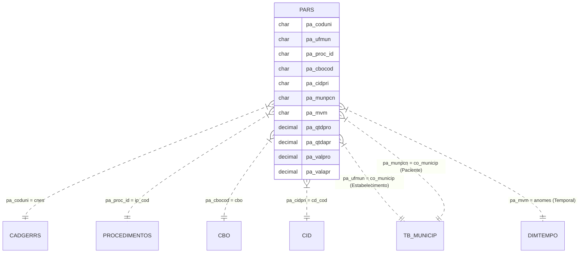

# T3 - Análise de Dados do SIASUS para Apoio à Gestão Municipal de Saúde de Ijuí/RS

> **Disciplina:** Programação para Ciência de Dados  
> **Tema:** Da Consulta SQL à Tomada de Decisão em Saúde Pública  
> **Tecnologias:** MySQL Server 8.0, MySQL Workbench, Python, Pandas, Matplotlib, Seaborn  

---

## 1. Situação-Problema e Objetivo

A Secretaria Municipal de Saúde de Ijuí/RS enfrenta o desafio constante de planejar, monitorar e avaliar a rede de serviços ambulatoriais do SUS ofertada tanto aos munícipes quanto a pacientes referenciados de municípios vizinhos pertencentes à 17ª Coordenadoria Regional de Saúde.

O **Sistema de Informações Ambulatoriais do SUS (SIASUS)** consolida milhões de atendimentos mensais. Contudo, seu volume massivo e complexidade de codificação dificultam a extração de inteligência em tempo hábil. 

### Pergunta Norteadora
> *"Como transformar os dados brutos do SIASUS em informações confiáveis para compreender a produção ambulatorial, identificar gargalos nos serviços de saúde e subsidiar o planejamento estratégico e a tomada de decisão da Secretaria Municipal de Saúde de Ijuí?"*

---

## 2. Estrutura e Modelagem do Banco de Dados (MySQL)

Para viabilizar a análise com alto desempenho, adotou-se o modelo relacional centrado na tabela de produção ambulatorial (`pars`), integrada às dimensões descritivas e territoriais através da **VIEW estratégica `pa_ijui`**:



### Volumetria do Banco de Dados (`dbsia`):
- **Tabela Central `pars`:** 4.421.514 registros (Produção Ambulatorial do RS)
- **Tabela `cadgerrs`:** 55.950 estabelecimentos cadastrados no CNES
- **Tabela `cbo`:** 2.813 ocupações profissionais do Ministério do Trabalho
- **Tabela `procedimentos` (`tb_sigtaw`):** 5.736 procedimentos da Tabela Unificada do SUS
- **Tabela `cid` (`s_cid`):** 14.705 diagnósticos da CID-10
- **Tabela `tb_municip`:** 5.657 municípios do Brasil (códigos IBGE de 6 dígitos)
- **Tabela `dimtempo`:** 203 períodos mensais com quebras em bimestre, trimestre e semestre
- **VIEW Estratégica `pa_ijui`:** **70.377 registros** específicos de atendimentos realizados nos estabelecimentos de Ijuí (`pa_ufmun = '431020'`).

---

## 3. Síntese dos Indicadores e Resultados da Análise

### 3.1. Indicadores Gerais e Recursos Financeiros
- **Total de Registros em Ijuí:** 70.377 atendimentos
- **Procedimentos Apresentados:** 525.295 unidades
- **Procedimentos Aprovados:** 398.830 unidades (**Taxa de Aprovação:** 75,92%)
- **Valor Apresentado pelos Prestadores:** R$ 6.954.718,70
- **Valor Efetivamente Aprovado (SUS):** R$ 6.840.233,87 (**98,35%**)
- **Glosa Financeira (Diferença):** R$ 114.484,83
- **Custo Médio por Procedimento Aprovado:** **R$ 17,15**

### 3.2. Ijuí como Hub Macrorregional de Saúde
- **Pacientes Residentes em Ijuí:** 34.647 registros (**49,23%**)
- **Pacientes de Outros Municípios:** 35.730 registros (**50,77%**)
- **Conclusão:** Mais da metade de toda a capacidade ambulatorial de Ijuí é consumida por moradores de outras cidades, confirmando seu papel de referência regional de média e alta complexidade.
- **Top Municípios de Origem:** Panambi (3.351), Jóia (2.609), Crissiumal (1.924), Catuípe (1.865), Santo Augusto (1.800), Augusto Pestana (1.712), Condor (1.289), Ajuricaba (1.128) e Cruz Alta (975).

### 3.3. Produção por Estabelecimento de Saúde
1. **Hospital de Clínicas de Ijuí (HCI):** Maior concentrador de atendimentos (24.265 registros, R$ 3,44 milhões aprovados). É a principal referência em oncologia, exames de alta complexidade e especialidades cirúrgicas.
2. **17ª Coordenadoria Regional de Saúde:** 7.573 registros e R$ 1,60 milhão aprovados, atuando no suporte de programas estaduais e dispensação estratégica.
3. **Rede Básica e Conveniada (UBS, CISA, Unilab, UPA):** Garantem capilaridade para atenção primária, consultas gerais e exames laboratoriais.

### 3.4. Perfil Epidemiológico e Demográfico
- **Predomínio de Gênero:** Pacientes do sexo feminino representam a maior parcela dos registros ambulatoriais.
- **Faixas Etárias:** Concentração expressiva nas faixas de 40–59 anos e 60–79 anos (doenças crônicas, hipertensão, diabetes, acompanhamento oncológico e auditivo).
- **Diagnósticos Mais Frequentes (CID-10):**
  - `H90.5` - Perda de audição neuro-sensorial (demanda massiva em saúde auditiva)
  - `F84.9` e `F84.0` - Transtornos do neurodesenvolvimento e autismo infantil (demanda crescente em saúde mental infantojuvenil / terapias especializadas)
  - `I51.6` - Doença cardiovascular não especificada

### 3.5. Foco em Áreas Críticas
- **Oncologia:** Alta densidade de valor financeiro alocado em tratamentos de quimioterapia e radioterapia no HCI.
- **Saúde Mental:** Forte procura por acolhimento e terapias multiprofissionais (psicologia e psiquiatria).
- **Atenção Básica:** Base de sustentação do município para controle de hipertensão e diabetes nas Unidades Básicas de Saúde.

---

## 4. Visualizações Desenvolvidas (Pasta `graficos/`)

| Arquivo | Descrição |
|---|---|
| `01_valores_ausentes.png` | Avaliação da qualidade e completude dos dados por atributo |
| `02_indicadores_gerais.png` | Comparativo de produção (Apresentada x Aprovada) em quantidade e R$ |
| `03_evolucao_mensal.png` | Linha temporal de acompanhamento da produção ambulatorial |
| `04_producao_estabelecimentos.png` | Ranking dos 10 estabelecimentos com maior produção e maiores glosas |
| `05_procedimentos_ocupacoes.png` | Top 10 procedimentos e ocupações profissionais mais demandadas |
| `06_demografia_sexo_idade.png` | Distribuição por sexo e histograma de distribuição etária |
| `07_heatmap_faixa_sexo.png` | Mapa de calor cruzando faixas etárias por sexo |
| `08_top_diagnosticos_cid.png` | Gráfico de barras horizontais dos principais CIDs atendidos |
| `09_fluxos_regionais_municipios.png` | Municípios de origem dos pacientes acolhidos em Ijuí |
| `10_areas_criticas.png` | Comparativo das áreas prioritárias (Oncologia, Saúde Mental, Atenção Básica) |

---

## 5. Como Reproduzir o Projeto

### Pré-requisitos
- **MySQL Server 8.0** com o banco `dbsia` criado.
- **Python 3.10+** com as bibliotecas:
```bash
pip install pandas mysql-connector-python matplotlib seaborn
```

### Execução dos Scripts
1. **Banco de Dados (MySQL):**
   - Execute o script `00_script_completo_banco_dbsia.sql` no MySQL Workbench para validar as tabelas e a VIEW `pa_ijui`.
2. **Processamento em Python:**
   - Execute o script principal:
   ```bash
   python analise_siasus_ijui.py
   ```
   - Ou abra o caderno interativo `Etapas 2 e 3 - Pandas e Visualizacao - DBSIA.ipynb` em seu Jupyter Notebook / VS Code.

---

## 6. Recomendações Estratégicas para o Gestor de Saúde de Ijuí

1. **Repactuação Interfederativa (CIR / CIB):* Como **50,77%** dos atendimentos são de cidadãos de outras comarcas, a Secretaria de Saúde de Ijuí deve pleitear maior aporte de recursos de custeio junto ao Estado e aos municípios de origem (Panambi, Jóia, Crissiumal, etc.) para cobrir os custos fixos da rede local.
2. **Mitigação de Glosas no HCI:** Observou-se uma diferença de 126 mil procedimentos entre apresentados e aprovados, decorrente de regras de autorização prévia (APAC/BPA). Recomenda-se capacitação contínua das equipes de faturamento para reduzir perdas.
3. **Expansão da Rede de Atenção Psicossocial (RAPS):** O volume expressivo de CIDs F84 (TEA) demanda ampliação de fonoaudiólogos, psicólogos e terapeutas ocupacionais credenciados no município.
